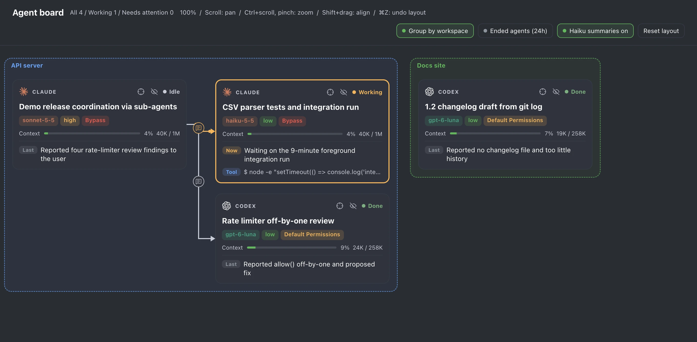

# Agent board

Agent board is a Paseo plugin that shows the agents of the current project as a live tree of cards. Each card shows the agent's status, provider, model, effort, permission mode and context use. Agents started by another agent sit beside their parent, joined by an arrow, and pressing the arrow shows the instructions the parent sent. Optional summaries from Claude Haiku give each card a short title and a line about what the agent is doing now. See [OVERVIEW.md](OVERVIEW.md) for the full description, including what data is sent where.



## Install

Once the plugin is listed in the Paseo plugin registry:

```bash
paseo plugin add geongyu09/paseo-agent-dashboard
```

From npm, which works now:

```bash
paseo plugin add npm:@geongyu09/paseo-agent-dashboard
```

## Requirements

- Paseo 0.15.3 or later.
- For Haiku summaries, the Claude Code CLI installed and signed in on the daemon machine. Summaries can be turned off with the switch in the board header, and the board works without them.

## Development

```bash
npm install
npm run typecheck
npm test
paseo plugin install /absolute/path/to/paseo-agent-dashboard
paseo plugin reload paseo-agent-dashboard
```

Run `paseo plugin reload paseo-agent-dashboard` after each change to load it into the daemon.

## Languages

The board is available in English, Korean and Simplified Chinese, and follows the app language.

## Credits

The Claude and OpenAI marks come from [Simple Icons](https://simpleicons.org) under CC0-1.0. Claude is a trademark of Anthropic, and OpenAI is a trademark of OpenAI. Their use does not imply endorsement.

## License

MIT. See [LICENSE](LICENSE).
